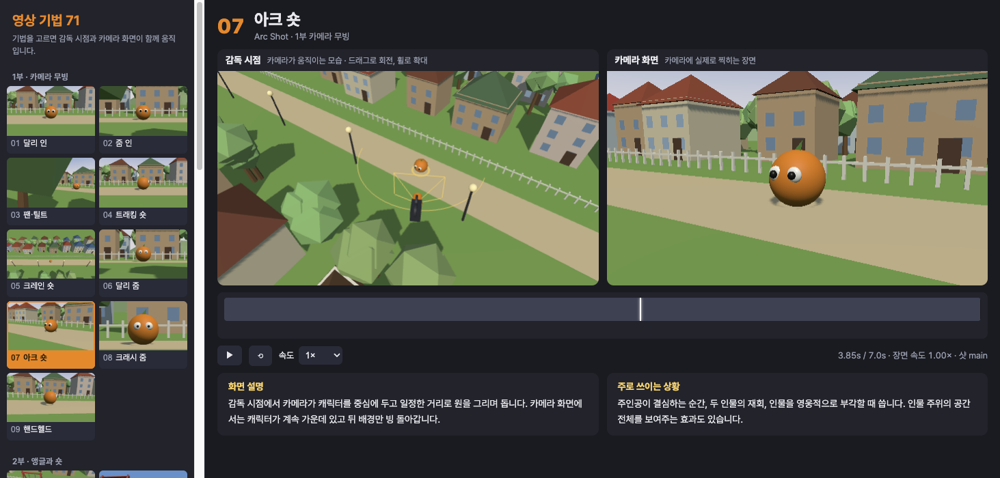
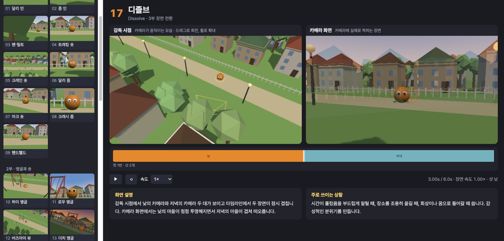
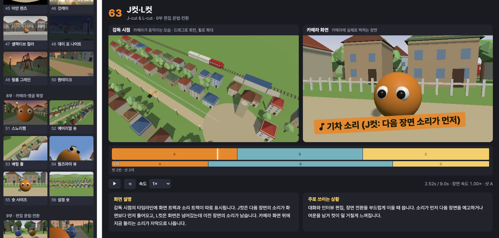
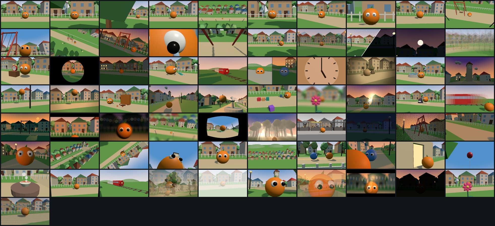
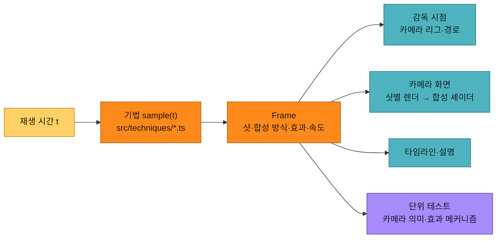

# 영상 기법 71 — three.js로 보는 촬영·편집 기법

영화와 유튜브에서 자주 쓰는 영상 기법 71가지를 three.js로 직접 움직여 보여주는 사이트입니다.
기법을 고르면 **카메라가 움직이는 모습(감독 시점)** 과 **카메라에 실제로 찍히는 화면** 이 나란히 재생되고,
아래에 화면 설명과 **주로 쓰이는 상황** 이 함께 나옵니다.

**사이트 바로 가기 → https://gyuha.com/filmmaking_techniques/**



## 화면 구성

선택한 기법 하나를 네 영역으로 보여줍니다.

| 영역 | 내용 |
|---|---|
| 기법 목록(왼쪽) | 10부로 묶은 71개 기법. 각 카드에 대표 장면 썸네일과 번호·이름이 있습니다. |
| 감독 시점(가운데 왼쪽) | 마을 전체를 위에서 보며 촬영 카메라 모형·시야 원뿔·이동 경로를 표시합니다. 드래그로 회전, 휠로 확대할 수 있습니다. |
| 카메라 화면(가운데 오른쪽) | 그 카메라가 실제로 찍는 결과 화면입니다. 전환·렌즈·색 효과도 여기에 적용됩니다. |
| 타임라인·설명(아래) | 컷이 바뀌는 구간, 장면 속도·밝기 그래프, 재생/일시정지/속도 조절, 화면 설명과 사용 상황입니다. |

여러 샷이 이어지는 기법(디졸브, 교차 편집 등)은 감독 시점에 카메라가 여러 대 보이고, 타임라인에 샷 구간이 색으로 나뉩니다.



소리와 화면이 따로 넘어가는 기법(J컷·L컷)은 타임라인에 소리 트랙이 하나 더 생기고, 지금 들리는 소리가 카메라 화면에 자막으로 나옵니다.



## 71가지 기법



| 부 | 기법 |
|---|---|
| 1부 카메라 무빙 | 01 달리 인 · 02 줌 인 · 03 팬·틸트 · 04 트래킹 숏 · 05 크레인 숏 · 06 달리 줌 · 07 아크 숏 · 08 크래시 줌 · 09 핸드헬드 |
| 2부 앵글과 숏 | 10 하이 앵글 · 11 로우 앵글 · 12 버즈아이 뷰 · 13 더치 앵글 · 14 익스트림 클로즈업 · 15 POV 숏 · 16 점프 컷 |
| 3부 장면 전환 | 17 디졸브 · 18 와이프 · 19 매치 컷 · 20 휩 팬 · 21 스매시 컷 · 22 아이리스 · 23 페이드 아웃 |
| 4부 편집 기법 | 24 몽타주 · 25 교차 편집 · 26 분할 화면 · 27 인서트 숏 · 28 플래시백 |
| 5부 시간 | 29 슬로 모션 · 30 타임랩스 · 31 스피드 램프 · 32 프리즈 프레임 · 33 리버스 · 34 하이퍼랩스 · 35 불릿 타임 · 36 스톱모션 |
| 6부 렌즈·빛·색 | 37 랙 포커스 · 38 렌즈 플레어 · 39 카메라 셰이크 · 40 모션 블러 · 41 컬러 그레이딩 · 42 레터박스 |
| 7부 특수 렌즈와 룩 | 43 보케 · 44 틸트 시프트 · 45 어안 렌즈 · 46 갓레이 · 47 셀렉티브 컬러 · 48 데이 포 나이트 · 49 필름 그레인 · 50 원테이크 |
| 8부 카메라·앵글 확장 | 51 스노리캠 · 52 에어리얼 숏 · 53 배럴 롤 · 54 웜즈아이 뷰 · 55 숏 사이즈 · 56 설정 숏 |
| 9부 편집 문법·전환 | 57 180도 규칙 · 58 숏/리버스 숏 · 59 컷 온 액션 · 60 아이라인 매치 · 61 쿨레쇼프 효과 · 62 인비저블 컷 · 63 J컷·L컷 · 64 리플 디졸브 · 65 화이트 플래시 |
| 10부 빛·렌즈·룩 | 66 강제 원근법 · 67 이중 노출 · 68 아나모픽 렌즈 · 69 하이키·로우키 조명 · 70 딥 포커스 · 71 글리치·VHS 룩 |

주소에 번호를 붙이면 해당 기법으로 바로 열립니다. 예: `?technique=6` (달리 줌), `?technique=35&t=3` (불릿 타임 3초 지점에서 정지)

1~50번의 목록과 분류는 유튜브 채널 **코드깎는노인** 의 영상 「영상 기법 효과 프롬프트 50개 다 가져가세요 | 바이브 영상 코딩」을 참고했습니다. 51~71번은 Wikipedia(*Cinematic techniques*, *Glossary of motion picture terms*)와 StudioBinder의 카메라 무빙·숏·앵글·편집 전환 가이드를 조사해 추가했습니다. 화면 설명·사용 상황 문구와 3D 장면은 이 프로젝트에서 새로 만들었습니다.

## 동작 방식

모든 기법은 **시간 t를 넣으면 그 순간의 촬영 상태를 돌려주는 순수 함수** `sample(t)` 하나로 정의됩니다.
돌려주는 값은 샷 목록(샷마다 카메라 위치·바라보는 점·화각·롤, 캐릭터·소품 상태, 장면 시간), 샷을 합치는 방식(단일·디졸브·와이프·아이리스·분할), 렌즈·색 효과 값, 장면 속도 배율입니다.
렌더러는 이 값을 그대로 화면에 옮기고, 테스트는 같은 값을 수학적으로 검사합니다. 그래서 "달리 줌이면 피사체 크기는 그대로이고 거리와 화각만 바뀐다" 같은 정의를 코드로 확인할 수 있습니다.



- 장면은 three.js 기본 도형으로 만든 단순한 로우폴리 마을입니다. 외부 3D 파일은 쓰지 않으며, 기법마다 필요한 소품(그네, 기차, 분수, 시계탑 등)만 켭니다.
- 카메라 화면의 전환과 효과는 자체 합성 셰이더 하나(`src/view/composite.ts`)가 처리합니다. 디졸브·와이프·아이리스·분할 화면·리플 디졸브·이중 노출, 피사계 심도·보케, 렌즈 플레어·아나모픽 빛줄기, 갓레이, 틸트 시프트, 어안, 컬러 그레이딩, 셀렉티브 컬러, 데이 포 나이트, 필름 그레인, 글리치·VHS, 화이트 플래시, 레터박스가 여기에 들어 있습니다.
- 모션 블러는 셔터가 열린 동안의 여러 순간을 겹쳐 그려서 만듭니다.

## 개발

Node 22 이상과 pnpm이 필요합니다.

```bash
pnpm install
pnpm dev          # 개발 서버 (http://localhost:5173)
pnpm build        # 타입 검사 + 프로덕션 빌드 → dist/
pnpm test         # 단위 테스트 (vitest)
pnpm e2e          # 브라우저 E2E (Playwright, 설치된 Google Chrome 사용, 약 5분)
pnpm thumbs       # 목록 썸네일 다시 찍기 → public/thumbs/
```

연출을 고친 뒤 목록 썸네일도 바꾸려면 `pnpm thumbs` 를 실행합니다. 기법마다 어느 시점을 찍을지는 `src/data/thumbs.ts` 에서 정합니다.

### 검사

| 명령 | 확인하는 것 |
|---|---|
| `tests/data.test.ts` | 기법이 정확히 71개이고, 이름·분류가 정답 목록과 같으며, 설명·사용 상황이 모두 채워져 있는지 |
| `tests/camera-semantics.test.ts` | 카메라 기법의 정의(달리 인은 거리만, 줌 인은 화각만, 아크는 거리 일정·방위각 변화, 스노리캠은 캐릭터에 고정, 180도 규칙의 축 등) |
| `tests/effects.test.ts` | 전환·편집·시간·렌즈·색 기법이 기대하는 메커니즘을 실제로 쓰는지(디졸브 중간 블렌드, 프리즈 정지 구간, 레터박스 2.39:1, J컷·L컷의 소리 선행·후행, 인비저블 컷의 가림 등) |
| `e2e/techniques.spec.ts` | 모든 기법을 실제로 눌러 두 화면이 그려지고, 시간에 따라 변하며, 설명이 맞게 나오고, 콘솔 오류가 없는지 |
| `e2e/distinct.spec.ts` | 모든 기법의 카메라 화면이 서로 모두 다른지(같은 애니메이션을 돌려 쓰지 않았는지) |

테스트는 기법이 정의대로 움직이는지만 확인합니다. 화면이 보기 좋은지는 직접 보고 판단해야 합니다.

## 배포

`main` 브랜치에 push하면 GitHub Actions(`.github/workflows/deploy.yml`)가 GitHub Pages로 배포합니다. 브라우저 E2E는 시간이 오래 걸려서 배포 과정에서는 돌리지 않습니다.

```
main에 push → 의존성 설치 → 단위 테스트 → 빌드(dist/) → GitHub Pages 배포
                              ↓ 실패
                           배포 중단
```

## 폴더 구조

```
src/
  data/          기법 71개 정보(설명·사용 상황), 썸네일 시점
  techniques/    기법 구현 — camera(1~16) · transitions(17~28) · time(29~36) · look(37~50) · extra(51~71)
  scene/         마을, 캐릭터, 기법별 소품
  view/          감독 시점, 카메라 화면, 합성 셰이더, 재생 관리
  ui/            사이드바·타임라인·설명 패널
tests/           단위 테스트
e2e/             브라우저 E2E
scripts/         썸네일 캡처 스크립트
public/thumbs/   목록 썸네일
docs/images/     README 스크린샷
```
